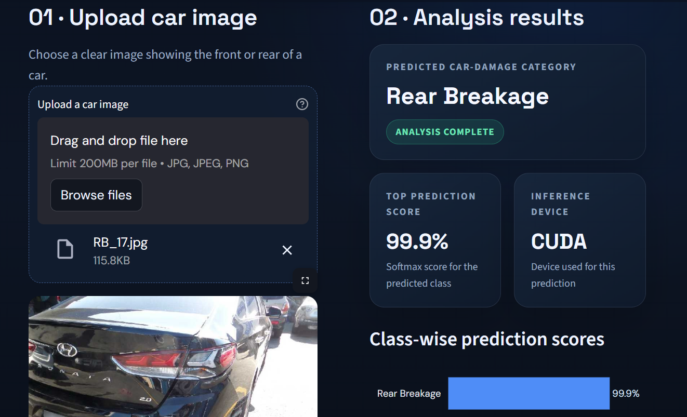
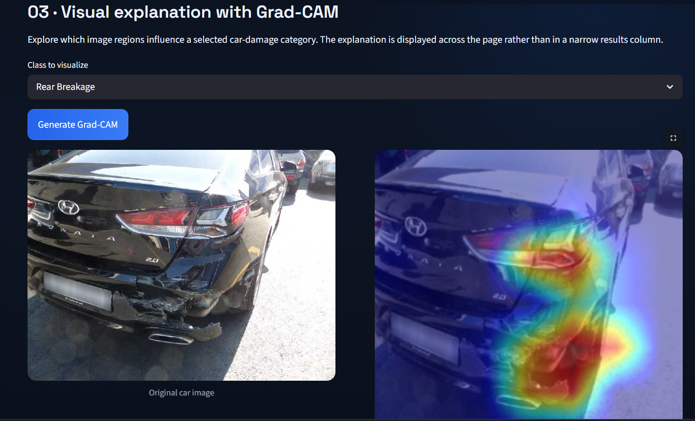

# CarSight: Intelligent Car Damage Analysis

**An end-to-end computer vision project for classifying visible vehicle condition from images.**

CarSight explores how deep learning can be applied to vehicle-image analysis, from model experimentation and evaluation to an interactive application. Given a car image, the application predicts one of six front/rear condition categories, presents class-wise prediction scores, and provides a Grad-CAM visualization to help interpret a selected prediction.

The project brings together **data preparation, CNN experimentation, transfer learning, hyperparameter tuning, model evaluation, explainability, and Streamlit deployment**.

<p align="center">
  
</p>

<p align="center">
  <strong>Technologies</strong><br>
  Python · PyTorch · Torchvision · Scikit-learn · Optuna · Streamlit · Grad-CAM
</p>

**Repository:** [CarSight on GitHub](https://github.com/parthgupta5555/CarSight-Car-Damage-Analysis)

---

<p align="center">
  <a href="https://carsight-car-damage-analysis-srheuudkyylif3kvaw3bye.streamlit.app/">
    <strong>🚀 Live Demo — Try CarSight</strong>
  </a>
</p>

## Contents

- [Project overview](#project-overview)
- [Application preview](#application-preview)
- [Problem and classification categories](#problem-and-classification-categories)
- [Project workflow](#project-workflow)
- [Model experimentation](#model-experimentation)
- [Application and inference](#application-and-inference)
- [Evaluation](#evaluation)
- [Explainability with Grad-CAM](#explainability-with-grad-cam)
- [Repository structure](#repository-structure)
- [Getting started](#getting-started)
- [Dataset](#dataset)
- [Scope and future improvements](#scope-and-future-improvements)

## Project overview

CarSight is a six-class image-classification proof of concept. It focuses on recognizing broad visible vehicle-condition categories from an input image and presenting the result in an accessible interface.

| Area | What the project includes |
|---|---|
| Computer vision task | Multi-class image classification |
| Model development | CNN baselines and transfer-learning experiments |
| Experimentation | Architecture comparisons and hyperparameter search |
| Evaluation | Overall and class-wise validation metrics |
| Explainability | Grad-CAM heatmap visualization |
| Application | Interactive Streamlit interface |
| Prediction output | Predicted category and class-wise scores |

### Key capabilities

- Upload a car image in JPG, JPEG, or PNG format.
- Predict one of six vehicle-condition categories.
- View scores for all six classes.
- Generate a Grad-CAM overlay for a selected class.
- Inspect the original image alongside the visualization.

## Application preview

### Home page


### Prediction results



### Grad-CAM visualization



## Problem and classification categories

The application predicts one of the following labels:

| Class index | Category | Description |
|---:|---|---|
| 0 | Front Breakage | Front view — breakage |
| 1 | Front Crushed | Front view — crushed condition |
| 2 | Front Normal | Front view — normal condition |
| 3 | Rear Breakage | Rear view — breakage |
| 4 | Rear Crushed | Rear view — crushed condition |
| 5 | Rear Normal | Rear view — normal condition |

The class order follows the alphabetical folder order used by `torchvision.datasets.ImageFolder`. The same order must be maintained by the trained model and inference helper.

## Project workflow

The project follows an end-to-end workflow:

```text
Image dataset
     |
     v
Image inspection and preprocessing
     |
     v
CNN and transfer-learning experiments
     |
     v
Hyperparameter tuning and model selection
     |
     v
Validation and class-wise evaluation
     |
     v
Saved model and inference pipeline
     |
     v
Streamlit application
     |
     +------> Predicted category and class scores
     |
     +------> Grad-CAM visualization
```

The notebooks contain the model-development and experimentation work, while the Python application files provide the interactive inference experience.

## Model experimentation

Rather than being limited to a single architecture, CarSight includes experiments with different approaches to image classification.

| Experiment | Purpose |
|---|---|
| Custom CNN | Establish an initial convolutional neural-network baseline |
| Regularized CNN | Explore regularization to improve generalization |
| EfficientNet-B0 | Evaluate a transfer-learning architecture |
| ResNet50 | Evaluate another transfer-learning approach; selected for the current application |

The notebooks document these experiments. The current Streamlit application uses the trained ResNet50 checkpoint; the other architectures are part of the development and comparison workflow, not separate models selectable in the deployed interface.

### Hyperparameter tuning

The hyperparameter-tuning notebook uses Optuna to explore learning-rate and dropout settings. The recorded best trial was approximately:

- Learning rate: `0.002107`
- Dropout rate: `0.4451`

The training notebook also records a final run using learning rate `0.005` and dropout `0.2`. These refer to different experiment records. The deployed model definition uses a dropout rate of `0.2`.

### Current application model

For the current inference application, the selected model is a fine-tuned ResNet50:

- ImageNet-pretrained feature extractor
- Earlier backbone layers frozen, with `layer4` fine-tuned
- Classification head: dropout followed by a six-output linear layer
- Input size: `224 × 224`
- Checkpoint: `saved_model.pth`

This describes the model currently integrated into the app; it is one part of the wider experimentation project.

## Application and inference

The Streamlit application connects the uploaded image to the trained model and presents the prediction.

1. The uploaded image is converted to RGB.
2. It is resized to `224 × 224`.
3. It is converted to a tensor and normalized using ImageNet mean and standard deviation.
4. The model produces six class scores.
5. The application displays the predicted category and class-wise scores.
6. Grad-CAM can be used to visualize regions that influenced a selected class score.

The model checkpoint is loaded from `saved_model.pth` by `model_helper.py`. Keep `app.py`, `model_helper.py`, and `saved_model.pth` together in the repository root.

## Evaluation

The training notebook reports the following validation results on **575 samples**:

| Metric | Score |
|---|---:|
| Accuracy | **79.83%** |
| Macro precision | 0.80 |
| Macro recall | 0.79 |
| Macro F1-score | 0.79 |
| Weighted F1-score | 0.80 |

### Class-wise validation report

| Category | Precision | Recall | F1-score | Support |
|---|---:|---:|---:|---:|
| Front Breakage | 0.82 | 0.82 | 0.82 | 113 |
| Front Crushed | 0.80 | 0.73 | 0.76 | 111 |
| Front Normal | 0.84 | 0.93 | 0.89 | 105 |
| Rear Breakage | 0.75 | 0.79 | 0.77 | 82 |
| Rear Crushed | 0.70 | 0.78 | 0.74 | 88 |
| Rear Normal | 0.90 | 0.70 | 0.79 | 76 |

**Evaluation note:** These figures are validation results reported by the training notebook, not results from a separate untouched test set. The notebook applies random image augmentation before splitting the dataset, meaning the validation subset also receives random augmentation. A stronger evaluation would use separate training and validation transforms, a reproducible stratified split, and an independent test set. The reported score should therefore be treated as an experimental validation snapshot rather than a measure of guaranteed real-world performance.

## Explainability with Grad-CAM

CarSight includes Grad-CAM to provide a visual aid for interpreting a selected model output. It produces a heatmap overlay that highlights image regions contributing to that class score.

Grad-CAM can help inspect model behavior, but it is not a damage-segmentation mask. It does not identify exact damage boundaries or prove that the model is relying on the right visual features.

## Repository structure

```text
CarSight-Car-Damage-Analysis/
│
├── app.py
├── model_helper.py
├── saved_model.pth
├── requirements.txt
├── README.md
├── LICENSE
│
├── notebooks/
│   ├── damage_prediction.ipynb
│   ├── hyperparameter_tunning.ipynb
│   └── gradcam_car_damage.ipynb
│
└── screenshots/
    ├── home page.png
    ├── prediction.png
    └── grad-cam.png
```

The notebook names shown above reflect the project structure discussed for this repository. If the files in your folder have different names, keep their actual names or update this section to match them.

## Getting started

### 1. Clone the repository

```bash
git clone https://github.com/parthgupta5555/CarSight-Car-Damage-Analysis.git
cd CarSight-Car-Damage-Analysis
```

### 2. Create and activate a virtual environment

**Windows — Git Bash:**

```bash
python -m venv .venv
source .venv/Scripts/activate
```

**Windows — Command Prompt:**

```bat
.venv\Scripts\activate
```

**macOS / Linux:**

```bash
python3 -m venv .venv
source .venv/bin/activate
```

### 3. Install dependencies

```bash
python -m pip install --upgrade pip
python -m pip install -r requirements.txt
```

For GPU acceleration, install a PyTorch and Torchvision build compatible with your CUDA setup by following the [official PyTorch installation guide](https://pytorch.org/get-started/locally/). CPU inference may also be used.

### 4. Run the application

Ensure that `app.py`, `model_helper.py`, and `saved_model.pth` are in the same directory, then run:

```bash
python -m streamlit run app.py
```

Open the local URL printed by Streamlit, usually `http://localhost:8501`.

## Dataset

The dataset was provided as part of the guided Deep Learning project by Codebasics. It contains images organized into the six vehicle-condition categories listed above.

The original dataset is not included in this repository. Please refer to the original course materials for dataset access and usage permissions.

## Scope and future improvements

CarSight is a learning and portfolio proof of concept for image classification. It predicts broad image-level categories and should not be treated as a professional vehicle-inspection or insurance-assessment system.

Potential next steps include:

- Re-evaluate using a clean, reproducible train/validation/test split.
- Compare model architectures using the same data splits and evaluation procedure.
- Add stronger error analysis for visually similar classes.
- Explore object detection or segmentation for damage localization.
- Evaluate robustness on images captured in varied lighting, angles, and environments.

---

*Built as a computer vision and deep learning project, covering experimentation through application development.*
